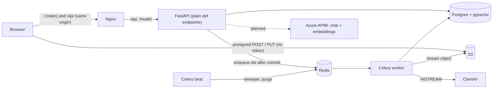
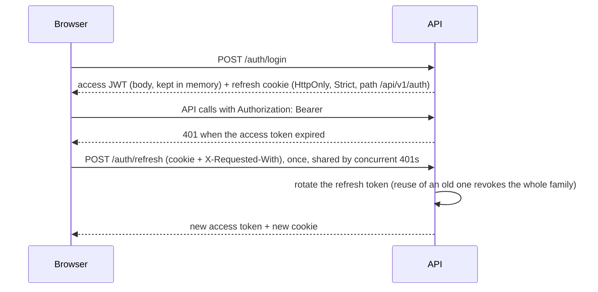
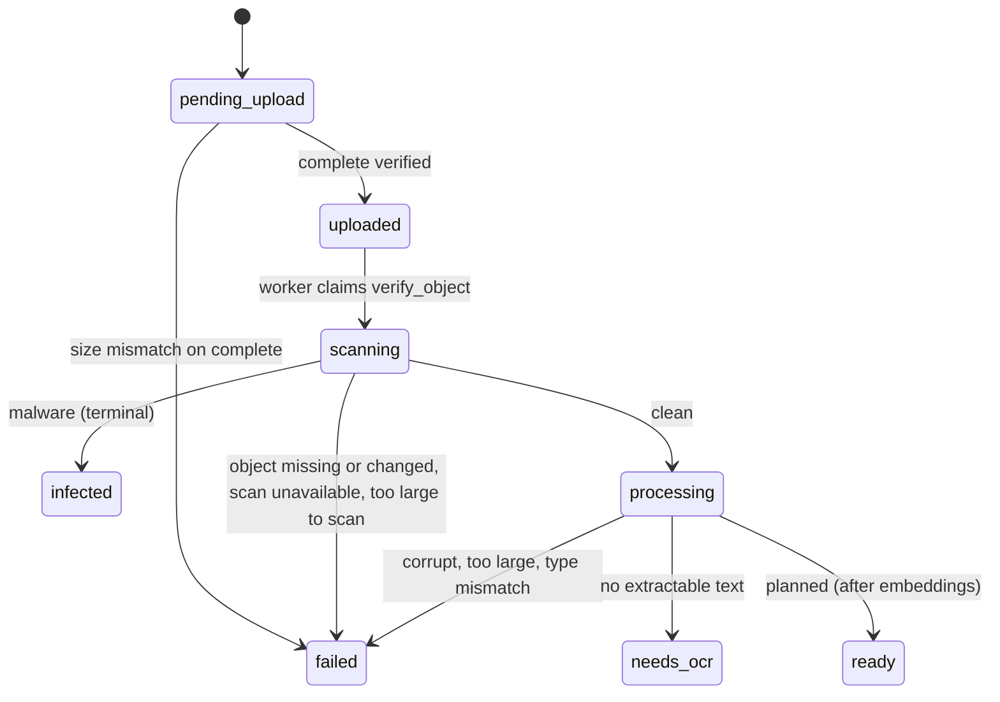

# Architecture

CloudDrop AI is a modular monolith: one FastAPI API, one Celery worker image (worker and beat), one Angular app. Postgres is the source of truth (including processing state); Redis is only the Celery broker and the rate-limit counters; files live in S3.

What is built today: authentication, folders and files, direct-to-S3 uploads (single and multipart), the processing pipeline (verify, scan, type detection, text extraction and chunking), purge, rate limiting. Planned and not built: sharing and permission inheritance, embeddings and semantic search, RAG chat, summaries and categories (see `tasks/todo.md`).

## System



## Upload flow

```mermaid
sequenceDiagram
  participant B as Browser
  participant A as API
  participant S as S3
  participant W as Worker
  B->>A: POST /files/uploads (name, size, type, folder)
  A->>A: validate size, type, quota and folder, create the pending file, generate the S3 key
  A-->>B: file + presigned POST (exact size and type)
  B->>S: upload (no Authorization header)
  B->>A: POST /files/{id}/uploads/complete
  A->>S: HeadObject: verify size, record ETag
  A->>A: status = uploaded, commit (a size mismatch deletes the object and fails the file; a repeat call changes nothing)
  A->>W: enqueue version id via Redis (after commit)
  W->>W: verify, scan, detect type, extract + chunk
```

Large files (over 100 MiB, up to 1 GiB) use `POST /files/uploads/multipart`: the server plans the parts, the browser PUTs each part to a freshly presigned address, and on complete the server lists the parts itself before assembling (ADR 0009).

## Auth flow



## Processing pipeline



State is a row per stage in `processing_jobs`; stages are idempotent and claimed atomically; a beat sweeper re-enqueues files whose message was lost. Files rest in `processing` until embeddings exist.

## RAG flow (planned)

Not built. The intended shape: embed the question with the same model as the documents, run one SQL query that filters by permission and orders by vector distance, send only the retrieved chunks (as untrusted data, never instructions) to the chat model, and return the answer with citations that link to server-returned file ids.

## Where to read more

- `docs/er-diagram.md`: tables and delete rules
- `docs/api.md`: endpoints, error codes, rate limits, storage setup
- `docs/adr/README.md`: architecture decisions
- `docs/security-review.md`, `docs/backup-restore.md`
- `README.md`: setup, running, containers
