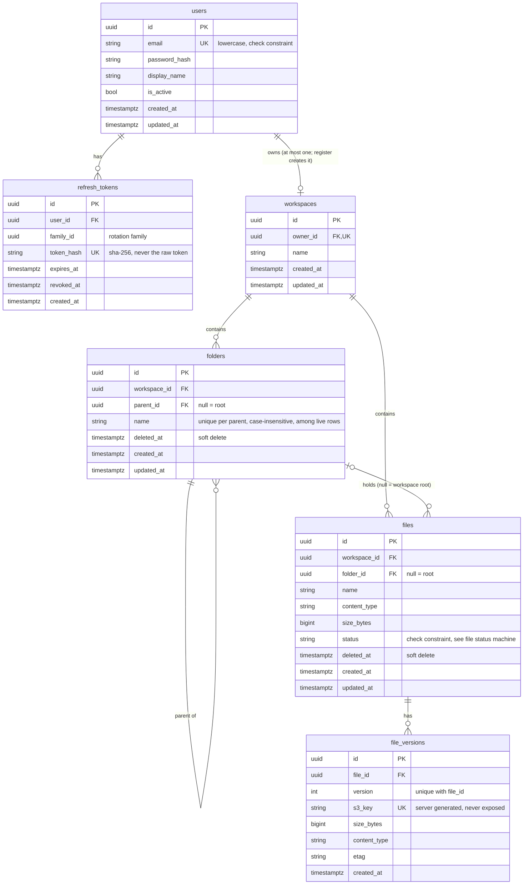

# Entity relationship diagram

Current schema after migrations 0001 and 0002. Primary keys are UUIDs generated by the database. All timestamps are `timestamptz` (UTC). Tables for sharing, audit, processing, chunks, embeddings and conversations are planned in later phases (see `tasks/todo.md`).



## Delete rules

- `refresh_tokens.user_id`, `workspaces.owner_id`, `folders.workspace_id`, `files.workspace_id` and `file_versions.file_id` cascade from their parent.
- `folders.parent_id` and `files.folder_id` are RESTRICT: a folder row with children cannot be hard-deleted. The API only soft-deletes, and refuses to delete a non-empty folder.
- Nullable columns: `refresh_tokens.revoked_at`, `file_versions.etag`, `folders.deleted_at`, `files.deleted_at`, `folders.parent_id`, `files.folder_id`.

## File status machine

```
pending_upload -> uploaded -> scanning -> processing -> ready
                               |            |
                            infected      failed        needs_ocr
```

Today the API sets `pending_upload`, `uploaded` and `failed`. The remaining states are set by the Phase 5 worker.
